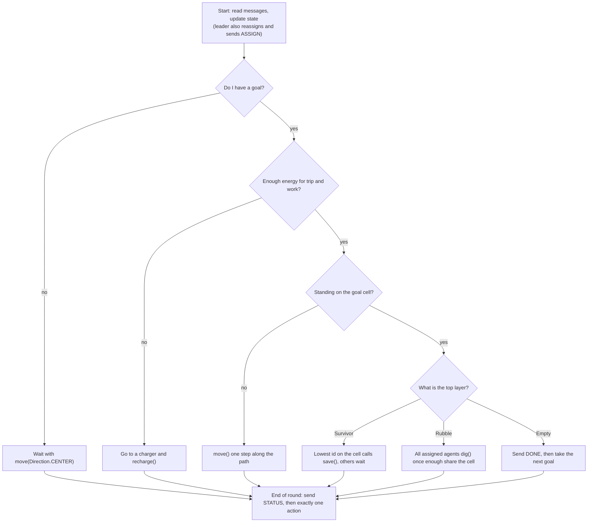

# CPSC 383 A2: Team Task Split

Nov 5, 2026 · Geffery Addai

## How the split works

Each member owns one slice of main.py plus the test maps for one or two of the five graded categories. When all four slices pass their maps, the program is done and ready to submit.

| Member | Owns in main.py | Tests categories | Submission duty |
| --- | --- | --- | --- |
| Member 1: Geffery Addai (GH: gefferyaddai) | Messaging, team state, leader, drone scans | 3 (observe the stack) | Header + AI-use appendix |
| Member 2: David Oti George (GH: DaveOGQ) | Map, pathfinding, energy, charging | 2 (charging) | Comment and citation pass |
| Member 3: Anant (GH: AnantShonak) | Goals, agents needed, splitting the team | 1 (alone vs together), 4 (split) | Fresh-install test run |
| Member 4: Morgan Lee (GH: morgan-swe) | Digging, saving, layers, re-planning | 5 (chain goals) | D2L upload |

Ground rules:

- One file only. The spec allows just main.py, no extra .py files, and no edits to the provided common files.
- Private repo only. The spec counts code other students could see, even passively, as plagiarism.
- Edit only the functions you own. Changing the shared state or message format needs a quick OK in the group chat first.
- Pull before you start, run at least one map before you push, keep commits small.
- Write your own code and log any AI help as you go. The AI-use appendix is required (this plan was drafted with Claude, so list it).

## Overall approach

We use a leader-based plan. Every agent shares its status each round, the lowest living id assigns agents to survivors, and every agent then runs the same decision flow (diagram below).

1. **Know the map.** In round 1 each agent caches move costs, KILLER cells and `get_charging_cells()` for the whole map, and reads the goals from `get_survs()`
2. **Share state.** Every round each agent broadcasts STATUS. Stacks seen up close or by `drone_scan()` go out as SCAN, so all 7 agents keep the same `state`
3. **Plan centrally.** The leader turns goals into assignments. A goal needs the highest `agents_required` in its stack (1 or 2), filled with the cheapest agents that can reach it. Every goal is staffed at the same time
4. **Act locally.** Each agent follows its assignment: shortest path to the goal, a charging detour if energy won't cover the trip plus the work, then dig or save
5. **Re-plan on events.** A DONE, a death, or a newly revealed layer makes the leader reassign, so freed agents move on to the next unfinished goal

Timing: in round 1 everyone broadcasts and waits, in round 2 the leader assigns, and agents start moving in round 3.

| Spec category | How we solve it | Main functions | Owner |
| --- | --- | --- | --- |
| 1. Alone or together | Reachability groups decide who can help; a goal only gets agents that can reach it | `reachable_from()`, `assign()` | M2, M3 |
| 2. Charging | Compare path cost plus work with energy; detour to a charging cell and `recharge()` until the trip fits | `energy_plan()`, `path()` | M2 |
| 3. Observe the stack | `drone_scan()` hidden stacks before staffing, so the right number of agents goes | `scan_if_needed()`, `agents_needed()` | M1, M3 |
| 4. Split for several goals | The leader staffs every goal in the same round, never one at a time | `assign()` | M3 |
| 5. Chain goals | Clear the cell layer by layer, then DONE frees the agents for the next goal | `act_at_goal()`, `on_goal_done()` | M4 |

Two timing rules that make it work:

- **2-agent dig.** At the start of a round, `get_cell_info_at(get_location()).agents` lists everyone on your cell. When it shows enough teammates assigned to this goal, all of them `dig()` that round. They all see the same list, so they dig together with no messages
- **Save.** Only the lowest id on the cell calls `save()`; the rest wait with `move(Direction.CENTER)`

## Decision flow per round

Every branch ends in the same place: one STATUS message and one action call. Each function in the member sections fills one box.

## Phase 0: shared setup (all four, tonight)
- please always refer to https://aegis-game.github.io/docs/

- [ ] Nothing else starts until this is pushed, because everyone codes against the same skeleton.
- [ ] Everyone runs `aegis init --type mas` and runs a shipped map with the 7 agents
- [ ] Open the 28 shipped maps (`challenge1_1` to `challenge5_4`) in the client and tag each with the spec category it tests. The file numbers may not match the spec's numbering
- [ ] Write the main.py skeleton together: header comment, one module-level `state` dict, and an empty stub for every function named in the member sections
- [ ] Agree the round order and message format below, then push to the private repo

Engine facts that shape the design (checked in the AEGIS source, v2.9.11):

| Fact | What it means for us |
| --- | --- |
| `think()` runs once per round per agent; module-level variables persist | Keep memory in a global `state` dict |
| One action per round: `move()`, `dig()`, `save()`, `recharge()` or `drone_scan()` | Every code path calls exactly one |
| Any error costs 10 energy; a turn over 1.0 s kills the agent | Check `on_map()` before moving, keep pathfinding fast |
| `move(Direction.CENTER)` stays put and costs 0 | This is how an agent waits |
| `send_message(msg, [])` broadcasts; it arrives next round via `read_messages()`, which keeps 5 rounds of `Message` objects (`.message`, `.sender_id`, `.round_num`) | Everything you hear is one round old |
| `get_cell_info_at(loc).layers` shows the full stack only if adjacent or drone scanned; otherwise just `top_layer` | Hidden stacks need a scan or a visit |
| `drone_scan(loc)` costs 2, shows that cell to the whole team for 5 rounds, starting next round | One scan per spot is enough |
| `dig()` removes rubble only if `agents_required` agents dig that cell the same round; each pays `energy_required` even when it fails | Never dig alone on 2-agent rubble |
| `save()` costs 1; only one save per cell per round counts | Only one agent on a cell saves |
| `recharge()` gives +5 on a cell from `get_charging_cells()` | Charging means parking for several rounds |
| Death at 0 energy or on a cell where `is_killer_cell()` is true | Pathfinding must block KILLER cells |
| Sandbox allows only os, typing, pathlib, random, heapq, math, json, re, enum, numpy. No `collections`. Names starting with `_` are rejected | Use `heapq` or lists for search, `json` for messages |

Round order, every agent, every round:

1. `read_messages()` and update `state`
2. Leader only: recompute assignments if something changed, broadcast ASSIGN
3. Pick one action from my assignment
4. `send_message(status, [])` (free)
5. Make exactly one action call

Message format: `json.dumps` of a dict with a type key `t`. Locations as `[x, y]`.

| Type | Sent by | Fields |
| --- | --- | --- |
| STATUS | Everyone, every round | id, loc, energy, goal |
| SCAN | Anyone who sees a full stack | loc, layers top to bottom (rubble agents and energy, or survivor) |
| ASSIGN | Leader | agent id to goal loc |
| DONE | Agent that empties a goal cell | loc |

## Member 1 (Geffery): messaging, team state, drone scans

Goal: every agent holds the same picture of the team and of every survivor's stack by round 3.

- [ ] `send_status()`: each round call `send_message(json.dumps({...}), [])` with `get_id()`, `get_location()`, `get_energy_level()` and the current goal
- [ ] `read_and_merge()`: loop over `read_messages()`, skip anything already handled (same `sender_id` and `round_num`), and update `state` for each message type
- [ ] Team table in `state`: per agent id, last location, energy, goal, and the round it was last heard. Treat an agent as dead after 2 silent rounds
- [ ] `am_i_leader()`: the lowest living id leads, so the next lowest takes over automatically if it dies
- [ ] Round 1: nobody has messages yet, so every agent broadcasts STATUS and waits with `move(Direction.CENTER)` unless it is scanning
- [ ] `update_stacks()`: for each location in `get_survs()`, store `get_cell_info_at(loc).layers` when the full stack is visible (adjacent or scanned); otherwise store only `top_layer` and mark it unknown
- [ ] `scan_if_needed()`: if a goal's stack is unknown and no teammate has claimed it, `drone_scan(loc)` and send SCAN next round. Only scan when David's `energy_plan()` says the 2 energy is affordable
- [ ] Log check: confirm whether `get_survs()` lists buried survivors and drops saved ones, and tell the team
- [ ] Tests: 1 own map where the stack is hidden and the number of agents depends on it, plus the shipped category 3 maps

## Member 2 (David): map, pathfinding, energy, charging

Goal: no agent ever steps on a KILLER cell or runs out of energy on any test map.

- [ ] `build_map()` in round 1: for every location where `on_map(loc)` is true, cache `get_cell_info_at(loc).move_cost` and `is_killer_cell()` in `state` (all move costs are visible in A2)
- [ ] `path(a, b)`: A* or Dijkstra with `heapq`, 8 directions, cost = the destination cell's `move_cost`, KILLER cells blocked. Reuse a member's A1 code and cite whose it is (the spec allows A1 code for pathfinding only)
- [ ] `next_move(goal)`: turn the first step into a `Direction` with `get_location().direction_to(step)`, then `move()`
- [ ] `reachable_from(loc)`: flood fill over non-KILLER cells. Anant uses it to tell who can reach whom
- [ ] `energy_plan(goal, work)`: compare `get_energy_level()` with path cost plus work at the goal (each `dig()` costs that rubble's `energy_required`, `save()` 1, `drone_scan()` 2) plus a small margin
- [ ] Charging detour: if the plan fails, route through the best cell from `get_charging_cells()`, call `recharge()` (+5 a round) until the rest of the trip fits, then continue
- [ ] Speed: cache paths and only replan when the goal or map knowledge changes, so turns stay well under the 1.0 s limit on a 30x30 map
- [ ] Tests: 1 own map that needs a charging stop, plus the shipped charging maps. Some shipped maps start agents with only 7 to 14 energy, so test those early

## Member 3 (Anant): goals, agents needed, splitting the team

Goal: on a map with 3 survivors, all three goals get their agents in the same round.

- [ ] `build_goals()`: one goal per location from `get_survs()`, holding the stack Geffery stored
- [ ] `agents_needed(goal)`: the highest `agents_required` over the `Rubble` layers in the stack (1 or 2; the spec says never more). Use the top layer until the full stack is known
- [ ] Alone or together: use `reachable_from()` to group agents by region. Only assign agents that can reach the goal, and let a cut-off agent work the goals in its own region
- [ ] `assign()` (leader only): give every goal its needed agents at once, cheapest `path()` cost first, so goals run in parallel. Category 4 is round-limited, so one-at-a-time loses marks
- [ ] Spare agents: back up 2-agent goals or wait near the next goal
- [ ] Broadcast ASSIGN. Non-leaders follow the newest ASSIGN and hold with `move(Direction.CENTER)` until the first one arrives
- [ ] Reassign when a STATUS goes silent (death), a DONE arrives, or a newly revealed layer changes the agents needed
- [ ] Tests: 1 own map each for categories 1 and 4, plus the shipped maps for both

## Member 4 (Morgan): digging, saving, layers, re-planning

Goal: a group clears a stacked cell, then moves on to a second survivor without help.

- [ ] `act_at_goal()`: on the goal cell, read `get_cell_info_at(get_location()).top_layer`. `Survivor` means `save()`, `Rubble` means `dig()` (paired if `agents_required` is 2), empty means the goal is done
- [ ] `dig_ready()`: for 2-agent rubble, dig only when `get_cell_info_at(get_location()).agents` shows enough teammates assigned to this goal. Everyone on the cell sees the same list at the start of the round, so they all dig together with no messages
- [ ] Partner not there yet: wait with `move(Direction.CENTER)` (free) instead of digging, since a failed dig still costs `energy_required`
- [ ] One saver per cell: only the lowest id on the cell calls `save()`; the others wait, because a second save that round does nothing
- [ ] Layer loop: a removed layer disappears at the end of the round, so re-read `top_layer` next round and keep going until the cell is empty. Cells can hold several survivors and rubble
- [ ] `on_goal_done()`: broadcast DONE, clear your goal, and wait for the leader's next ASSIGN. If none comes within 2 rounds, head for the nearest unfinished goal
- [ ] Tests: 1 own map with stacked survivors and chained goals, plus the shipped category 5 maps

## Timeline

Due Nov 7, 2026, so we have about two and a half days. Aim to submit by 6 PM Saturday to keep a buffer (check the exact D2L deadline; late within 24 hours costs 10%). The 28 shipped maps are the main test set; own maps are one per category.

1. Nov 5 tonight: Phase 0 call (about 2 hours), skeleton pushed before bed
2. Nov 6 by 5 PM: everyone finishes their slice against the stubs, testing on the shipped maps for their own category
3. Nov 6, 6 PM checkpoint call: merge, run all 28 shipped maps, list what fails and whose slice it is
4. Friday night to Saturday noon: fix integration bugs until every shipped map passes; each owner adds their own test map
5. Nov 7, noon to 4 PM: commenting pass, header, AI appendix, fresh-install run
6. Nov 7 by 6 PM: upload to D2L

## Submission checklist

Style and commenting are worth 5 of the 20 marks, so these count as much as one category.

- [ ] Geffery: header comment at the top of main.py with all four names, date, course, semester and tutorial
- [ ] Geffery: AI-use appendix (tool, how it was used, how the output was used). Only main.py is submitted, so put it in a comment block there and confirm with the TA
- [ ] David: every function commented; the A1 pathfinding author cited; any outside algorithm cited with its full URL
- [ ] Anant: fresh `aegis init --type mas` in a new folder, drop in only our main.py, run all shipped maps and our own test maps
- [ ] Anant: confirm there are no extra .py files and the provided common files are untouched
- [ ] Morgan: upload main.py to the Assignment 2 GROUP dropbox in D2L, then download it back and compare it to the repo copy